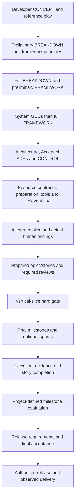
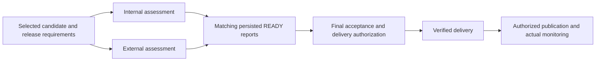

# Workflow Examples

These diagrams illustrate the catalog's dependencies. They do not replace manual work or evidence.

Missing required evidence blocks the dependent conclusion. For session recovery, hooks read bounded
checkpoint regions; the user/agent verifies current substantive files. Explicit rotation archives
narrative without implying task completion or review approval.
